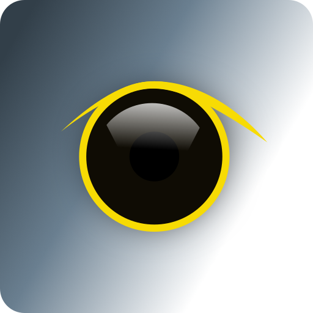
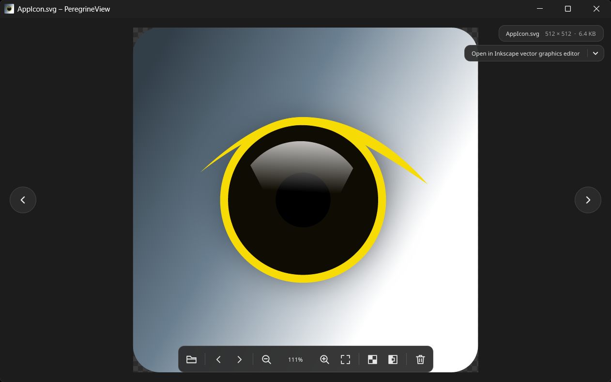
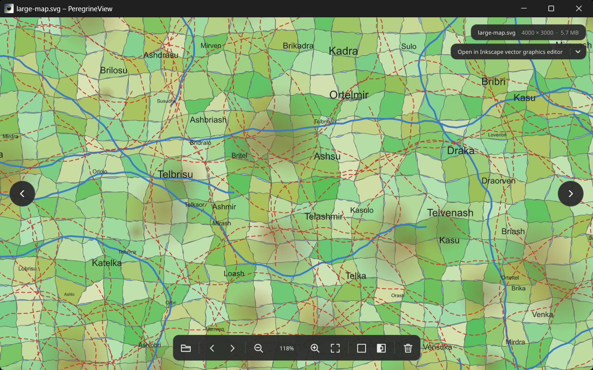
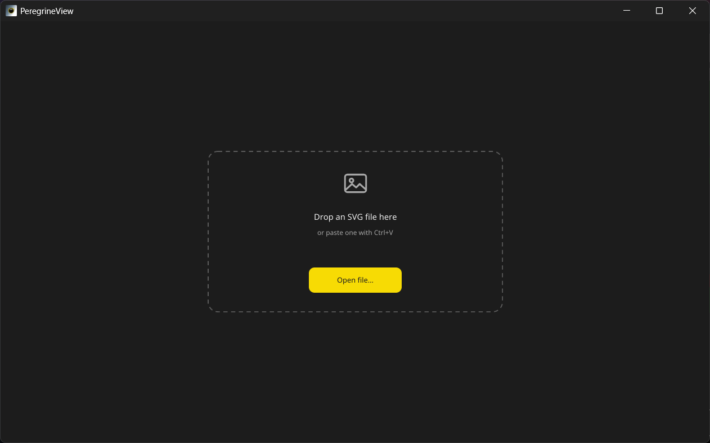

<p align="center">
  
</p>

<h1 align="center">PeregrineView</h1>

<p align="center">A fast, lightweight SVG viewer for Windows, macOS and Linux, written in Rust.</p>

PeregrineView does one job: it opens any SVG quickly and lets you look at it smoothly, at any zoom level. It draws on the CPU with [resvg](https://github.com/linebender/resvg), with no web engine and no GPU, and the whole app is a single exe under 5 MB.

The name comes from the peregrine falcon, the fastest animal, with very sharp eyes. That matches the two goals: speed and sharp detail.



## Features

- **Opens fast.** The window shows up in under 100 ms, and a simple SVG is on screen in under 50 ms.
- **Smooth and sharp.** Zoom and move at 60 fps. When you stop, the visible part is drawn again at full detail, sharp on HiDPI screens too.
- **Big files don't freeze it.** Loading and drawing run in the background, so even a 6 MB map stays responsive.
- **Many ways to open a file.** Double-click it, drag and drop it, use Ctrl+O, paste a file or SVG code with Ctrl+V, or pass it on the command line.
- **Next and previous.** Step through the other SVGs in the same folder.
- **Auto reload.** When the file changes on disk, the picture updates and keeps your zoom and position.
- **Backgrounds.** Checkerboard, white or dark behind the picture, and theme, white or dark around it. Both are remembered.
- **Open in your editor** (Windows). Send the file to Inkscape, Illustrator or another app in one click.
- **Delete** moves the file to the Recycle Bin or Trash, after asking.
- **Handles real-world files.** Reads `.svgz`, UTF-16 files, files with no size or no `viewBox`, sizes in mm, cm or in, and linked images.
- **Light and dark** UI that follows the system theme.



## Install

Download the latest version from the [Releases page](https://github.com/Shehan17/peregrine-view/releases):

| File | What it is |
| --- | --- |
| `peregrineview_<version>_x64-setup.exe` | Installer. Installs for the current user (no admin prompt) and registers `.svg` and `.svgz`. |
| `peregrineview_<version>_x64-portable.zip` | Just `PeregrineView.exe`. Runs without installing. |

Only Windows is packaged for now. On macOS and Linux, build it from source (see below).



## Keyboard shortcuts

On macOS, use Cmd in place of Ctrl.

| Key | Action |
| --- | --- |
| Ctrl+O | Open a file |
| Ctrl+V | Paste an SVG file or SVG code |
| `+` / `-` | Zoom in / out |
| `0` or `F` | Fit to window |
| `1` | Switch between 100% and fit |
| Arrow keys | Move the view |
| Page Down / Space | Next SVG in the folder |
| Page Up / Backspace | Previous SVG in the folder |
| `B` | Change the background |
| Shift+`B` | Change the window background (around the picture) |
| `R` | Reload the file |
| `E` | Open in the default editor (Windows) |
| Shift+`E` | Choose the editor (Windows) |
| F11 | Full screen on or off |
| Delete | Move the file to the Recycle Bin or Trash |
| Ctrl+W or Ctrl+Q | Close |

With the mouse: the wheel zooms at the cursor, drag to move, and double-click zooms in 2× (Shift+double-click zooms out). On a trackpad, scroll with two fingers to move and pinch to zoom.

## Build from source

You need [Rust](https://rustup.rs) (stable).

```sh
cargo build --release
cargo run --release -- path/to/file.svg
cargo test
```

## Scope

PeregrineView is a viewer only. It doesn't edit SVGs, run scripts or play animations. Keeping it small is what keeps it fast. [CONTRIBUTING.md](CONTRIBUTING.md) has the speed targets and how to help.

## Contact

Questions or ideas? Email [shehanrashmika1217@gmail.com](mailto:shehanrashmika1217@gmail.com), or open an issue on [GitHub](https://github.com/Shehan17/peregrine-view/issues).

## License

PeregrineView is free and unencumbered software released into the public domain under the [Unlicense](LICENSE). Anyone can copy, change, sell or use it for any purpose, commercial or not, with no permission needed and no credit required.

The UI font, Noto Sans (`assets/fonts`), keeps its own [SIL Open Font License](assets/fonts/OFL.txt).
